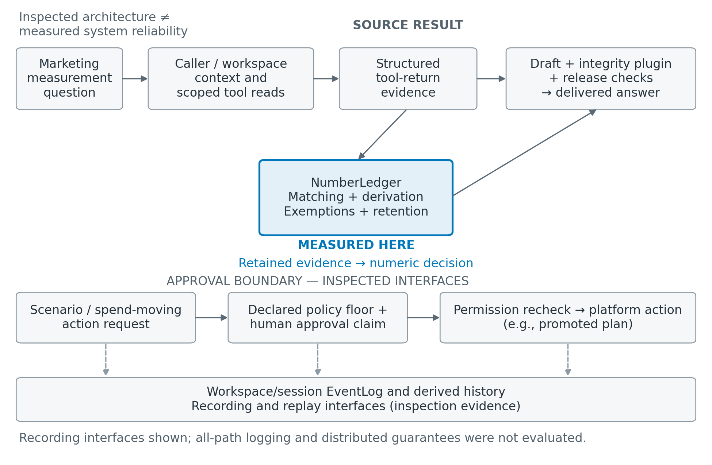
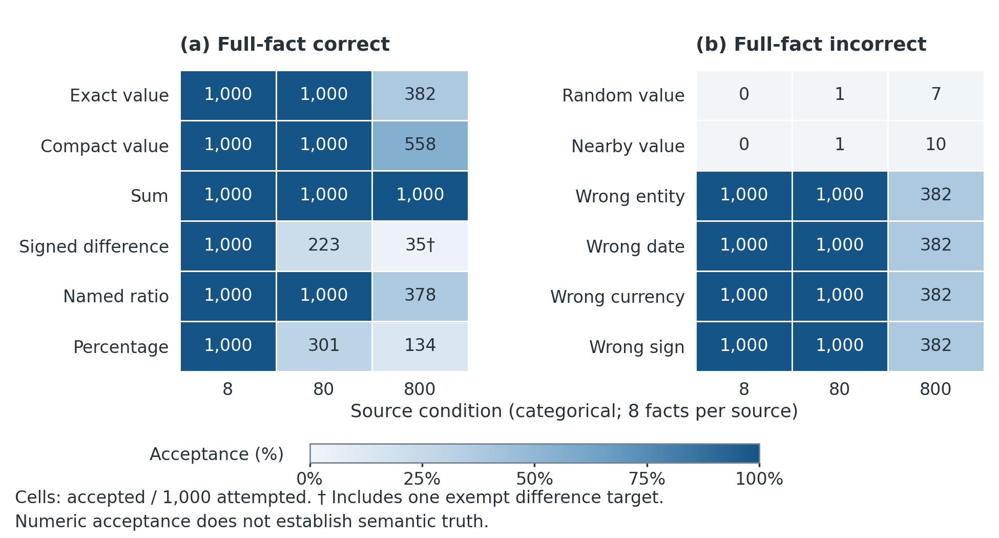
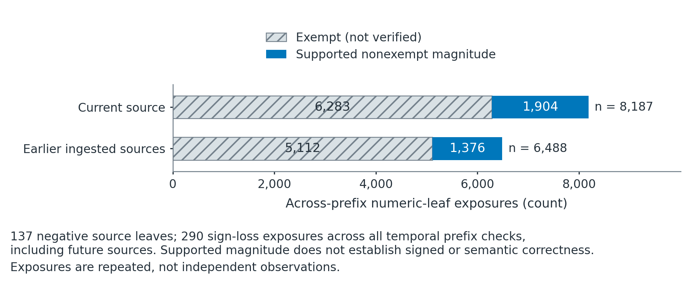
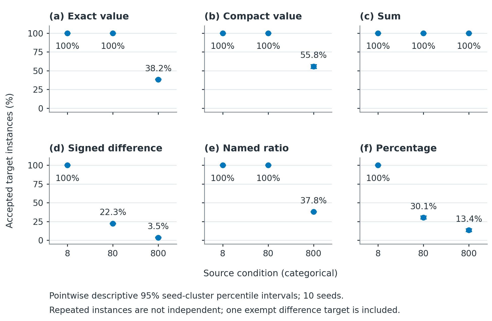

# LAH: An Evidence-Aware Agent Harness for Marketing Measurement

Anil Kumar Singh\
Lifesight · anil@lifesight.io

## Abstract

AI agents for marketing measurement must connect heterogeneous analytical evidence to consequential decisions without losing what the evidence means or who is authorized to act. A revenue figure, attribution estimate, saturation curve, and experimental effect carry different assumptions; reproducing their numbers does not establish a correct interpretation or permission to change a budget. We present the Lifesight Agent Harness (LAH), an architecture that treats evidence availability, numeric support, semantic correctness, causal validity, and action authority as distinct obligations. LAH combines workspace-scoped execution records, invocation-scoped deterministic workflows, explicit action policies, human approval handling, and separate representations for coded findings and model judgments. We develop a conditional indistinguishability observation: a checker that maps correct and incorrectly bound claims to the same representation cannot distinguish their validity from that representation alone. To characterize one implemented mechanism, we evaluate NumberLedger, LAH’s numeric-support component, using 36,000 synthetic claim instances and an exploratory reconstruction of development tool returns. The findings expose a gap between numeric acceptance and factual binding: incorrect entity, period, currency, or sign variants can pass, while retained evidence and quotable evidence need not coincide. The contribution is a systems design and reproducible component characterization that make these boundaries explicit for marketing-measurement agents. The empirical evidence concerns the numeric component; it does not establish end-to-end reliability or improved marketing outcomes.

## Keywords

marketing measurement; agent harnesses; numeric provenance; evidence availability; semantic binding; human approval

## 1. Introduction

A marketing leader asking which channels can scale next quarter is asking for more than a table of numbers. An answer may combine reported spend and revenue, a media mix model’s estimated contribution, a response curve’s saturation behavior, and an experiment’s estimated incremental outcome. Those objects have different evidential meanings. Bayesian media mix modeling can represent advertising carryover and diminishing returns and derive return on ad spend (ROAS) and marginal ROAS from posterior samples; the resulting quantities remain conditional on the model and its inputs \[1\]. Causal interpretation also depends on the available data, selection process, and modeling conditions \[2\]. An agent therefore needs to preserve what a numerical result measures, as well as its displayed magnitude.

Consider a constructed case used throughout this paper, rather than an observed customer episode. A chief marketing officer (CMO) asks an assistant to compare channels A and B, identify saturation and remaining headroom, and evaluate a proposed quarterly budget scenario. The assistant must distinguish the revenue attributed by an advertising platform from model-derived channel contribution and from an experiment-derived incremental effect. It must preserve the spend denominator, currency, channel, observation window, and reference scenario when discussing ROAS. Finally, comparing a proposed allocation and promoting a plan are different actions: the latter changes the authorized spending configuration and requires a decision by a permitted person. No empirical revenue, allocation, or business-lift figures are assigned to this illustration.

This workflow exposes an evidence-to-answer gap. A correct tool return can be omitted from the final answer, quoted after its usable evidence has been displaced, or attached to the wrong channel or period. A supported magnitude can also appear in an incorrect statement. Our component measurements demonstrate that possibility directly: altered entity, date, and currency bindings are accepted whenever the tested magnitude remains acceptable (Section 4.2). A system that records tool use and a system that verifies claim meaning consequently establish different properties. ReAct’s interleaving of reasoning, actions, and observations provides a useful interaction model, but observations still require an explicit treatment when they become claims \[3\].

A marketing-measurement harness must keep evidence availability, numeric support, semantic correctness, causal interpretation, and permission to act distinct. LAH supplies inspectable interfaces for execution records, scoped state, action policies, approval handling, and separate coded findings and model judgments. Inspection establishes interface presence and shape, not deployed isolation, complete audit delivery, or answer correctness (Appendix C).

The paper makes three bounded contributions:

- **Inspectable integration.** An implementation account connects evidence, scoped workflow state, distinct checks, and action authority to a marketing-measurement turn, with explicit inspection limits.
- **Reproducible component characterization.** A prospectively frozen NumberLedger study separates generated-record factual bindings from finite-policy numeric support: 36,000 instances across twelve families, three source-volume conditions, and ten population seeds; 144,000 scored arm calls complete without checker exceptions or retries (Section 4; Appendix B).
- **Return-shape evidence accounting.** An exploratory reconstruction separates nonexempt support, exemptions, and temporal exposures in development returns. The reproduction materials are publicly archived on Zenodo (<https://doi.org/10.5281/zenodo.24036084>); raw workspace data is excluded.

The favorable and unfavorable findings are inseparable. All six valid families receive target acceptance in the eight-source condition. At 800 sources, sum acceptance remains 1,000/1,000, while exact direct claims receive 382/1,000, signed differences 35/1,000, named ratios 378/1,000, and percentages 134/1,000. Wrong entity, date, currency, and sign instances also pass when their magnitudes remain acceptable. These observations expose operation-specific support, retention limits, and semantic and sign boundaries; they do not estimate one overall LAH accuracy rate.

A separate exploratory cohort adds realistic return shapes without supplying population validity. Current-code reconstruction of captured offline responses yields seventeen successful-return prefixes from seven previously inspected development groups in one workspace. Across 14,675 ingested numeric exposures, 3,280 nonexempt magnitudes receive support, while 11,395 exposures are exempt. Exemptions are bypasses rather than verified facts. Negative source occurrences and sign-loss exposures further limit interpretation, and this cohort does not stress direct-value eviction. Its successful literal quotability therefore coexists with the synthetic failures.

Three research questions (RQ1–RQ3) organize the paper. RQ1 asks how the inspected implementation organizes evidence, identity, authority, and checking across a marketing-measurement turn. RQ2 asks which claim families receive numeric support under fixed synthetic policies and source-volume stress conditions. RQ3 asks what reconstructed current-tool returns establish about literal numeric quotability, and what they leave unknown. We answer these questions through an architecture account, reproducible component measurements, and explicit assurance boundaries. The contribution is this concrete integration and its measured limits. It neither asserts priority over numeric verification protocols nor reports comparative full-agent efficacy, improved causal marketing measurement, or better spending outcomes.

## 2. Problem formulation and related work

### 2.1 Claims, evidence, and assurance objects

For this paper, represent a numerical claim schematically as

``` math
c=(v,e,m,w,u,k,o,f,r),
```

where $`v`$ is the displayed value, $`e`$ the entity, $`m`$ the metric, $`w`$ the time window, $`u`$ the unit and display scale, $`k`$ the currency where applicable, $`o`$ the operation, $`f`$ the measurement/source family, and $`r`$ the reference scenario. This is an analytical definition of the obligations a statement can carry, not a claim that the tested component validates every field. In the constructed CMO case, the same displayed ROAS can refer to a platform-reported attribution total, a model-conditional response, or an experiment’s intervention contrast. Equality of the displayed number does not make those estimands interchangeable \[4\].

We distinguish three evidence properties operationally. Evidence availability concerns whether relevant source material or operands remain accessible in the representation being examined. Numeric support concerns whether the implemented policy can associate a displayed magnitude with retained evidence or an allowed derivation. Semantic correctness concerns whether the statement binds that value to the right object, metric, window, units, currency, and operation. In our synthetic evaluation, factual labels are relative to generated source records and declared Decimal arithmetic, rather than external business truth. Table 1 specifies the measured objects and the corresponding limits.

**Table 1. Assurance properties and their measurement boundaries.**

| Property | Operational question | Evidence in this study | What it does not establish |
|----|----|----|----|
| Evidence availability | Is relevant raw evidence still present, or is its direct text quotable? | Raw retention and direct-fact-text checks | Correct entity identity, complete recoverability, or source truth |
| Numeric support | Does the component permit the target magnitude? | `explained` target decisions and finite-policy labels | Full claim meaning or causal interpretation |
| Semantic correctness | Does a claim agree with its generated source binding and operation? | Independent synthetic full-fact labels | Natural-language validity or correct real-world measurement |
| Exemption | Does policy bypass evidence checking for this span? | Explicit exempt counts | Verification or positive evidence |

These are useful distinctions rather than a universal containment theorem. Rounding, alternative derivations, coincident values, exemptions, and incomplete oracle coverage complicate any proposed implication. A constructed statement that transfers channel A’s revenue magnitude to channel B can pass a magnitude check while being false relative to its intended record. Conversely, an older truthful fact may become unavailable in a bounded raw pool, even while another retained derivation permits its magnitude. Section 4 measures both situations without treating a checker decision as a proof of the whole tuple.

**Explanatory observation: binding indistinguishability.** Fix evidence state $`E`$. Suppose a deterministic checker uses a representation $`\pi(c)`$ of a claim and returns $`V(c,E)=g(\pi(c),E)`$. If a correct claim $`c`$ and an incorrect-binding claim $`c'`$ satisfy $`\pi(c)=\pi(c')`$, then $`V(c,E)=V(c',E)`$. The checker therefore cannot both accept the correct member and reject the incorrect member of that pair. The proof is substitution of equal representations into the same deterministic function with the same evidence state.

This is a conditional information-loss observation, not a new general theory or an empirical guarantee. Its premise must be established for the particular pair; the representation is not assumed to be only a magnitude. Named derivations, parsing, operands, and exemption rules can also affect a NumberLedger decision. Table 3 reports counterexamples for the tested syntax rather than proving indistinguishability for every possible claim, and sign loss has a distinct parser mechanism.

### 2.2 Marketing measurement and neighboring verification work

Marketing measurement makes preservation of the tuple consequential. Jin et al. describe carryover, diminishing returns, Bayesian parameter estimation, and posterior ROAS/marginal-ROAS summaries \[1\]. A response-curve claim about headroom therefore needs its spend level and uncertainty, not only a point estimate. Chan and Perry discuss the data and inferential conditions relevant to causal media mix modeling \[2\]. This motivates retaining model identity and assumptions; it does not imply that media mix modeling is intrinsically noncausal or that a provenance mechanism establishes identification.

Experimental and attribution evidence require comparable care. Vaver and Koehler describe geographic regions assigned to advertising treatment and control conditions \[5\]. Gordon et al. report that observational estimates often differed from randomized estimates in their advertising-experiment setting despite extensive covariates \[6\]. Kelly et al. formulate attribution through decision-specific causal estimands \[4\]. Together these sources motivate retaining design and estimand provenance. They do not validate LAH’s causal judgments or establish that every observational approach fails.

Combining measurement methods introduces further provenance obligations. Paid-search bias correction uses explicit causal adjustment conditions, while Bayesian media mix model calibration can incorporate experimental information through a reparameterized ROAS prior \[7\], \[8\]. The calibration report distinguishes experimental and modeling windows. A marketing assistant must retain those estimands and windows when comparing results; numeric support does not establish the assumptions required to combine them.

Tool interaction and executable arithmetic address neighboring parts of the workflow. Toolformer executes and filters sampled application programming interface (API) calls for model training \[9\]. Program-aided Language Models (PAL) and Program of Thoughts delegate computation expressed in generated programs to an interpreter \[10\], \[11\]. Such execution separates calculation from language generation, but the chosen program and operands still matter. FinQA’s annotated financial reasoning programs and TAT-QA’s table/text evidence, aggregation, and explicit answer scale illustrate the importance of this separation \[12\], \[13\]. We do not report LAH scores on those benchmarks.

Source support also has several units of assessment. ALCE separates fluency, correctness, and citation quality; FActScore decomposes generated prose into atomic factual propositions evaluated against a knowledge source \[14\], \[15\]. Their constructs differ from occurrence or derivability of a numeric magnitude. Prompted Aspect Key Point Analysis (PAKPA) quantifies review-key-point prevalence through comment membership, with bounded comment–key-point support evaluation \[16\]. These mechanisms provide context, not interchangeable accuracy denominators or direct baselines for our runner.

Relevant numeric mechanisms include Proof-Carrying Numbers (PCN) and VeriFin. In the inspected PCN v1, numeric spans bind to structured claims, and a renderer applies declared exact, rounding, alias, or qualified-tolerance policies while leaving unbound spans unverified \[17\]. VeriFin v3 independently establishes filed operands and authorized formulas, binds concepts, periods, and units, and uses Z3 to check candidate arithmetic constraints, including abstention \[18\]. These are stronger binding contracts than the magnitude policy measured here. No head-to-head performance comparison was executed, and we do not claim that LAH replaces either pipeline.

Financial verification work also evaluates objects broader than a magnitude pool. FinGround decomposes financial answers into typed atomic claims and reconstructs formulas for computational checks \[19\]. AuditFlow separates adaptive investigation from typed executable evidence checks, while VeNRA organizes grounding and execution around a typed fact ledger \[20\], \[21\]. These mechanisms limit any claim that LAH originates deterministic numerical verification. FinVerBench treats evidence observability, reporting precision and prompt assumptions as evaluation design choices \[22\]. The comparisons concern methods; no external benchmark score becomes a LAH accuracy estimate.

Deterministic checks also require policy-specific evaluation. Thokal studies two ordered scaling rules as representation correction rather than general reasoning correction \[23\]. Chahed separates convention-dependent reference values, numerical fidelity and partial source attribution \[24\]. These distinctions reinforce our separation of numeric support from full-fact correctness; a matching cited input does not establish full semantic or accounting truth.

Table 2 contrasts the units of assessment that are most easily conflated. Its purpose is conceptual comparison, with no common test set, cost budget, or cross-paper efficacy ranking. The distinction between an arithmetic constraint and a full proposition is especially relevant when a budget recommendation combines several source families.

**Table 2. Mechanism comparison, restricted to the inspected literature versions.**

| Mechanism | Unit and evidence | Relevant boundary |
|----|----|----|
| PAL / Program of Thoughts | Generated program executed by an interpreter | Execution remains conditional on the program and operands |
| ALCE / FActScore | Citation-linked answer or atomic proposition | Propositional support differs from numeric matching |
| PCN v1 | Numeric span bound to a structured claim and renderer policy | Binding contract exceeds a magnitude-pool match |
| VeriFin v3 | Grounded operands, formulas, concepts, periods, units, and solver constraints | Validity remains conditional on grounded inputs |
| LAH component here | Target magnitude under retained numeric state and declared policy | Semantic and causal correctness are separate endpoints |

The literature mechanisms in Table 2 are supported by the corresponding sources above \[10\], \[11\], \[14\], \[15\], \[17\], \[18\].

### 2.3 Evidence scope

Runtime organization supplies a different contribution. Event sourcing reconstructs state from ordered changes \[25\]. CaMeL separates control and data flow and enforces capability policies through an interpreter \[26\]. Self-Refine and Reflexion use feedback through iterative refinement or retained reflections \[27\], \[28\]. LAH integrates records, policy, and checking for its application, without importing those systems’ empirical or security guarantees.

Jin et al. describe HEELO, which composes task-specific harnesses from reusable agent-native primitives and uses environment evidence to guide targeted revision \[29\]. A primitive typically applies its resource through a resident model, while the framework also permits implemented procedures where an exact operation is available. This is close work on composition and evidence flow. LAH examines a complementary boundary: what numeric support establishes about a marketing-measurement claim and how such evidence is separated from action authority. HEELO’s platform also includes campaign workflows, budget controls, audit logs, and human approval \[29\]. Those capabilities alone are therefore not a distinguishing claim for LAH.

Our evidence has four levels: inspected implementation, identified repository tests without a new pass claim, executed component measurements, and exploratory reconstruction. Related work is claim-specific narrative context for this systems/component study. A separately preserved broader systematic/scoping review remains unfinished; this paper makes no exhaustive prior-art or field-wide novelty claim. This distinction follows the need for suitable holdouts and explicit evaluation boundaries emphasized in agent-evaluation work \[30\]. The next section describes what code inspection establishes before asking what the component experiments measure.

## 3. LAH design and implementation

### 3.1 Execution records and scoped authority

The inspected LAH implementation organizes a turn around typed records rather than relying solely on a transcript of generated prose. Strict event envelopes identify workspace and session, and the append/read contract assigns monotonically increasing per-session sequence numbers. Optional idempotency keys provide a deduplication interface for events that use them. The inspected in-memory implementation supports this contract; the existence of the interface does not establish distributed durability or universal deduplication. Appendix C identifies the source locations and distinguishes interface inspection from execution evidence.

A derived history maps user, model, and tool events into model-facing messages, applies logged compaction, and omits audit-only events. This arrangement separates an execution record from the particular history representation supplied to a model. It applies the established reconstruction principle of event sourcing to an agent turn \[25\]. Canonical SHA-256 functions and a tap fingerprint make representations observable, but a serialization failure can yield an empty request hash. We therefore make no universal claim that a request hash equals a derived-history hash, or that hashing attests semantic completeness. Reconstructing messages also differs from deterministically reexecuting external actions.

In the constructed CMO workflow, this record structure would distinguish a request to compare channel mix, a tool call for source results, a scenario computation, and a later approval decision. The distinction matters when an answer quotes a revenue amount whose supporting return was earlier in the turn. A record can identify which result was received and when; it cannot by itself prove that the model correctly associated the amount with channel A, that the platform computed it correctly, or that the estimate licenses a causal interpretation. Those obligations remain separate from recording.

Caller resolution requires a workspace identifier, a user identifier, and a forwarded bearer, and rejects known Google identity-token issuers. The inspected function relies on the gateway trust boundary rather than performing complete JavaScript Object Notation (JSON) Web Token (JWT) and membership validation itself. The log’s user check is optional in its API. These details delimit the claim: the code supplies explicit caller and workspace seams, but our inspection is not a penetration test or certification of tenant isolation. For the constructed spending scenario, an apparent user request cannot substitute for the caller context expected at those seams.

Workflow calls also receive call-specific run identities and scoped working-state access. Per-node policies declare retry, timeout, and concurrency behavior; a nonisolated serialization path remains explicit in the runner. This design makes the unit of working state a particular invocation rather than an undifferentiated collection of conversational keys. The inspected mechanism is relevant when the CMO compares successive scenarios: the intended distinction between those computations is represented in execution state. It does not prove that every future graph uses the seam correctly or that deployed concurrent executions cannot interfere.

Capabilities are assembled from pack tool definitions into a shared registry. Reusing definitions reduces the need to describe an analytical capability separately at each entry point, but registry reuse is not evidence that every caller has identical authorization or that interactive and protocol surfaces behave identically. We avoid historical tool and pack counts because they do not establish the property of interest. Figure 1 instead presents the interfaces that carry identity, evidence, checks, and action authority, while marking the much smaller component boundary exercised by our measurements.

<figure>

<figcaption aria-hidden="true">Figure 1. LAH’s marketing-measurement workflow and component-evaluation boundary.</figcaption>
</figure>

Figure 1 summarizes inspected interfaces for caller/workspace context, tool-result evidence, numeric checking, approval handling, and EventLog/history. Blue marks NumberLedger, the measured component. Other interface boxes are implementation inspection, not empirical end-to-end validation or security guarantees. The spend-moving branch depicts the declared policy floor, approval claim, and permission recheck. The plugin and release checks include behavior outside the component experiment; recording interfaces do not establish complete all-path logging or semantic correctness. Numeric acceptance does not establish semantic correctness or causal validity.

### 3.2 Policy, approval, and distinct checks

LAH separates a model’s narration from permission to execute declared actions. The policy engine imposes a human-approval floor on tools registered as spend-moving and rejects configuration below that floor. It also consults workspace-scoped overrides and turn denials. For the constructed case, explaining a model-conditional allocation and promoting a plan must therefore be represented as different operations. A plausible recommendation does not confer authority to change the spending configuration. This is an implementation-level separation whose scope is the declared registry, rather than a guarantee covering undiscovered side effects.

Approval resolution reserves a pending approval through compare-and-set lease transfer, records a resolution, and holds the session guard. The implementation also reconciles a consumed claim whose expected log event is absent. At execution, declared permission is checked again, and failures become logged error results. These mechanisms make approval consumption and execution eligibility inspectable. However, lease admission and the external platform effect are different events. The lease and log do not form one transaction, and code inspection does not establish exactly-once external effects, crash recovery, or cancellation fencing.

The audit path has a further limit: a policy audit-append error is logged without aborting the turn, so the policy decision remains applied even when its audit append fails. This prevents an assertion of universal audit completeness. It also illustrates why an architecture diagram should identify interfaces and their failure boundaries rather than shade an entire execution path as certified. Capability-based runtime work such as CaMeL similarly makes policy enforcement an explicit mechanism with stated assumptions; our numeric experiments do not transfer its security properties to LAH \[26\].

The checking path distinguishes two origins of evidence. `InvariantFinding` records a coded observation, while `VerificationResult` records a model’s judgment. Inspected coded checks examine plan structure, result presence, reconciliation visibility, redactions, orientation contradictions, and budget disclosure. Observations are classified separately from findings that trigger repair. A successful-tool-presence check establishes that such a result exists, not that each answer clause is semantically bound to it. Likewise, a model verdict remains a judgment even when it agrees with a deterministic check.

This distinction is relevant to revision. Self-Refine’s same-model feedback and refinement and Reflexion’s retained linguistic reflections describe mechanisms for adaptation, rather than independent factual labels \[27\], \[28\]. The inspected MT-Bench math substudy also distinguishes default, chain-of-thought, and separately generated reference-guided judging; its reference is model-generated \[31\]. LAH’s event types preserve who or what produced a finding. The component study does not test whether subsequent model repair corrects every unsupported statement.

### 3.3 Numeric-support policy and retained state

NumberLedger is the numeric component studied here. It stores source-specific numeric values together with structured bases, named fields, counts, currency annotations, and totals. Its support policy combines numeric extraction, precision-aware matching, specified derivations, exemptions, and bounded retention. Appendix A reports the exact thresholds and kind-specific exemptions. In particular, a 5,000-distinct-value trigger and an eviction target based on held occurrences are different quantities, while the base and group pools have separate limits. None is one universal capacity for every evidence band. The key design distinction is between retaining an occurrence of a raw value and retaining structured information from which a permitted magnitude can be recognized. Different state bands can persist differently, so a single statement that “the evidence was evicted” is insufficiently precise.

At the public component interface, `explained(text)` reports numeric decisions, while `find_ungrounded(text)` evaluates the text through the component path. In the experiment, the target decision for the displayed claim value is kept separate from all-token text acceptance and whole-text acceptance. This matters because canonical claim text contains operation and operand information as well as the target value. A pass on one target is not automatically a pass on every numeric token in the sentence, and neither is a semantic proof of the surrounding proposition. Appendix A states the evaluated grammar and label policy.

Precision-aware matching allows a compact or rounded display to differ from an exact source spelling. Named ratios, structured totals, and groups permit some derived quantities without requiring every accepted magnitude to appear as a raw leaf. Newly derived named-multiplier prose checks displayed operands, while a directly grounded multiplier can remain grounded even if subsequent operand prose is inconsistent, as specified in the frozen protocol. We do not describe every arithmetic relation as globally permitted: the source-specific structure and the policy’s declared derivation scope constrain the mechanism.

Exemptions require a separate interpretation. Small-number and year-related bypass rules are part of the inspected support policy, but an exempt span has not thereby received evidence verification. The experiment records exemptions instead of folding them into an unqualified “grounded” count. It also records unparsed targets. This is particularly important for a marketing response containing dates, identifiers, small percentages, and monetary values, where a numeric-leaf census mixes different roles. Dedicated testing of all exemption thresholds, zero cases, and locale syntax is outside the completed evaluation.

Retention affects raw values and structured support differently. The frozen study leaves actual default bounds unchanged and captures retained state rather than inferring it from configured limits. Stored per-source values and bases can be displaced while named, count, group, or total information persists. An accepted sum after operand eviction may therefore reflect structured support, whereas a failed difference may lack usable operands in the policy’s search space. The measurements identify those outcomes; attributing every individual pass to one unique internal mechanism would require additional tracing.

The retained-state distinction suggests a practical reading of a ledger snapshot. A source-specific value records a numeric occurrence; a base supports bounded arithmetic search; named fields identify structured operands; groups and totals encode aggregation structure; and currency annotations record an attribute without proving the complete currency binding of the sentence. These roles should be examined separately when interpreting an acceptance. A raw-only comparator deliberately removes most of that structure. Its agreement or disagreement with the component is consequently a description of two policies, rather than evidence that the component has recovered the original semantic record.

The production integrity plugin is broader than these two component calls. It harvests structured results and session content and applies later cross-source derivation treatment and formatting. Consequently, a component acceptance or rejection cannot be substituted for the final production answer. The running CMO example clarifies the difference: a policy may recognize a revenue/spend magnitude, while later narration still must retain the channel, forecast window, uncertainty, and measurement family. The experiment neither measures that complete narration path nor validates the underlying response curve.

### 3.4 What the architecture establishes

The implementation account answers RQ1 through explicit seams: typed records organize execution evidence, scoped runs organize working state, policy and approval handling organize declared authority, and distinct finding types organize check provenance. These are concrete design facts at the inspected revision. They are not a validated taxonomy of trustworthy autonomy, a demonstration that all model-visible content is recoverable, or evidence that every tool result is correct. Appendix C retains the relevant code anchors and distinguishes available tests from tests newly executed for this study.

For marketing measurement, the resulting design obligation is to keep numerical evidence and action authority addressable across an analysis. Source-family labels and estimand metadata would make that addressability more informative, but the present component does not enforce the complete claim tuple defined in Section 2. The empirical question is therefore intentionally narrower: under a fixed policy, what numeric support remains available, which values are accepted, and which constructed semantic errors survive? Section 4 answers that question before Section 5 considers the remaining distance to a whole-harness evaluation.

## 4. Evaluation: protocol and results

### 4.1 Evaluating numeric support and claim correctness

The synthetic evaluation asks whether a numeric-support decision can distinguish a correct claim from one that reuses an acceptable number with an incorrect binding. We evaluate NumberLedger on 36,000 claim instances spanning twelve families, including direct quotations, arithmetic transformations, and deliberately altered claims. Ten seeded datasets are evaluated at three evidence volumes: 8, 80, and 800 sources. Each seed–volume condition includes 100 instances per family. The protocol was fixed before scoring, and the component was executed in isolation without language-model, network, or platform calls. This design measures the numeric mechanism rather than the behavior of a complete agent. Appendix B documents the executable snapshot, evaluation paths, and reproduction procedure.

Each source supplies spend, revenue, cost, and margin for two synthetic entities, giving eight numeric facts with explicit identities, date windows, units, and currency. Claims specify an operation, its operands, the associated source attributes, and a displayed value. Values are constructed with decimal arithmetic and converted to floats only when passed to the component. This controlled representation makes particular errors identifiable, but it does not test unrestricted natural-language interpretation. All evaluation paths receive the same evidence and claim within a condition. Across source volumes, the queried identities change; the volume conditions therefore describe different stress settings rather than a causal experiment that changes only retention capacity.

We assess claim correctness separately from numeric support. The full-record reference label checks the displayed result and its entity, metric, unit, date window, and currency against the generated source records. Arithmetic claims also require compatible operands and the declared aggregation or comparison scope. A separate numeric reference checks signed raw values and specified within-source arithmetic while ignoring those bindings. These labels answer different questions: a number may have numeric support while its surrounding claim is incorrect. Label construction does not call NumberLedger’s matching code, but it shares derivation and display/rounding helpers with the generator; it is not an independently implemented oracle. The numeric reference also omits some valid aggregation, grouping, counting, and restatement mechanisms, so its unsupported label cannot by itself establish a production error. Appendix A gives the precision and derivation rules.

The protocol was specified before the scored runs, but the generator and claim families were used during development; this is not an independent-domain evaluation. Repeated claim texts also reduce the effective diversity of the test set: the 1,200 instances in each condition contain 188, 980, or 1,200 unique texts at 8, 80, or 800 sources, respectively. We therefore estimate uncertainty across the ten seed populations, using 10,000 jointly paired seed-cluster bootstrap resamples. The resulting intervals are pointwise and descriptive, without simultaneous coverage, multiplicity adjustment, or a power guarantee. Repeated claims are not treated as independent observations. Appendix B records the exact seeds and analysis settings.

The primary outcome is whether NumberLedger accepts the claim’s displayed target value through `explained`. This is distinct from checking every numeric token, the final formatter, or an agent’s delivered answer. We also run `find_ungrounded` and two raw-value references: one searches facts actually retained by the component, and the other searches the complete generated inventory. These references help distinguish missing evidence from a support-policy decision. They do not check claim bindings or displayed operands, and they exclude structured totals, groups, pairwise arithmetic, and restatement support. Their different policies prevent an equivalent-checker interpretation. The analysis reports exemptions, parsing coverage, missing pairs, and undefined seed strata explicitly rather than replacing them with zeros or discarding them.

### 4.2 Family outcomes and retention

Table 3 reports every family–volume cell for the current target decision. Each denominator is 1,000 instances: one hundred from each seed. Correctness here means agreement with the declared full-fact oracle. The table does not pool unlike families into an overall accuracy estimate.

**Table 3. Accepted target instances / 1,000 under the current `explained` path.**

| Family            | Full-fact label |   8 sources |  80 sources | 800 sources |
|-------------------|-----------------|------------:|------------:|------------:|
| Exact direct      | Correct         | 1,000/1,000 | 1,000/1,000 |   382/1,000 |
| Compact direct    | Correct         | 1,000/1,000 | 1,000/1,000 |   558/1,000 |
| Sum               | Correct         | 1,000/1,000 | 1,000/1,000 | 1,000/1,000 |
| Signed difference | Correct         | 1,000/1,000 |   223/1,000 |    35/1,000 |
| Named ratio       | Correct         | 1,000/1,000 | 1,000/1,000 |   378/1,000 |
| Percentage        | Correct         | 1,000/1,000 |   301/1,000 |   134/1,000 |
| Random value      | Incorrect       |     0/1,000 |     1/1,000 |     7/1,000 |
| Nearby value      | Incorrect       |     0/1,000 |     1/1,000 |    10/1,000 |
| Wrong entity      | Incorrect       | 1,000/1,000 | 1,000/1,000 |   382/1,000 |
| Wrong date        | Incorrect       | 1,000/1,000 | 1,000/1,000 |   382/1,000 |
| Wrong currency    | Incorrect       | 1,000/1,000 | 1,000/1,000 |   382/1,000 |
| Wrong sign        | Incorrect       | 1,000/1,000 | 1,000/1,000 |   382/1,000 |

<figure>

<figcaption aria-hidden="true">Figure 2. Numeric target acceptance across twelve families and three source conditions.</figcaption>
</figure>

Figure 2 visualizes Table 3. All 36,000 prescribed instances completed. No target was unparsed. One accepted difference target at 800 sources was exempt rather than evidence-verified; all other target decisions had zero exemption tokens. Canonical generated syntax and repeated texts limit the interpretation, and changed query identities prevent a causal volume reading. Acceptance is a numeric policy decision, not semantic correctness or whole-harness reliability.

All valid families pass at eight sources, but operations differ thereafter. At 800 sources, the descriptive seed-macro rate for exact direct claims is 38.20% \[37.70%, 38.80%\], compact direct 55.80% \[52.90%, 58.10%\], differences 3.50% \[3.10%, 3.90%\], named ratios 37.80% \[37.50%, 38.00%\], and percentages 13.40% \[11.50%, 15.30%\]. Sum acceptance is 100.00% \[100.00%, 100.00%\]. These pointwise intervals describe the fixed synthetic setting; a degenerate observed interval does not prove zero risk. Appendix B provides all valid-family intervals and comparator contrasts. The percentage family displays generated revenue/spend multipliers of 3.01–8.98 as approximately 301–898%, above the percentage exemption for absolute values at most 200. These outcomes characterize nonexempt ratio-as-percentage magnitudes, not ordinary 0–100% shares.

The semantic perturbations reveal a distinct boundary. Wrong entity, date, and currency cases are accepted in 1,000/1,000 instances at both eight and eighty sources and 382/1,000 at eight hundred. That is a constructive counterexample to interpreting magnitude support as validation of the claim tuple, rather than violation of an advertised semantic checker. Wrong signs additionally expose parser behavior: the display parser loses the minus sign and can match the positive magnitude. The sign result therefore concerns signed fidelity as well as missing semantic binding.

Sign and scale handling are established evaluation concerns: TAT-QA explicitly discusses preserving signs in numerical answer evaluation \[13\]. Our sign diagnostic characterizes this pinned component; it is neither a claim to discover sign sensitivity nor a TAT-QA benchmark result.

Random and nearby perturbations need independent numeric labels because they can coincide with another permitted value. Under the finite signed raw/within-source-pair oracle, accepted/unsupported counts for random values are 0/1,000, 0/998, and 1/965 across the three conditions; nearby values give 0/1,000, 1/999, and 5/974. Wrong-sign counts are 1,000/1,000, 1,000/1,000, and 377/982. These denominators differ from Table 3’s semantic labels. Omitted production support rules prevent interpreting them as a universal false-acceptance rate.

Retention and literal quotability also diverge. Across ten seeds, raw retention and direct-fact-text quotability are both 640/640 at eight sources and 6,400/6,400 at eighty. At eight hundred, 23,976/64,000 raw facts remain, whereas 24,286/64,000 direct-fact texts are quotable. Only 378/1,000 exact direct-query instances have raw support retained; all pass, while 382 pass overall. Sum acceptance remains complete even though only 378 instances retain both raw operands. Structured support, alternative matches, and rounding can outlast raw/base eviction, without preserving the intended semantic identity of every accepted magnitude.

For illustration of the comparator limitation, exact direct acceptance at 800 sources exceeds the raw-retained comparator by 0.20 percentage points \[0.00, 0.50\], whereas compact direct acceptance exceeds it by 7.10 points \[5.20, 8.80\]. Sum acceptance differs by 99.80 points \[99.50, 100.00\]. These are paired descriptive seed-macro contrasts under different policies, not estimated benefits of enabling a particular production derivation rule. The compact result can reflect matching precision as well as availability, and the sum result contrasts permitted arithmetic with a reference that intentionally excludes it. Complete contrasts remain inspectable in Appendix B.

### 4.3 Reconstructed current-tool return cohort

The separate reconstruction uses captured offline Hypertext Transfer Protocol (HTTP) results from seven previously inspected development groups nested in one workspace. Current code reconstructs tool returns; these are not the original model-visible historical egress. Fourteen context objects are excluded, so wrapper/context arguments do not become result evidence. Eighteen actual tool attempts include seventeen successes and one preserved error. Seventeen successful-return prefixes have no ingestion, checking, or prefix exceptions. No live model or platform call is involved. Table 4 retains every pseudonymous group rather than presenting only an aggregate favorable result.

**Table 4. Reconstructed cohort accounting. Supported counts are nonexempt magnitudes.**

| Local group | Source numeric occurrences | Prefixes | Ingested exposures | Exempt | Supported |
|----|---:|---:|---:|---:|---:|
| development-01 | 1,010 | 2 | 1,010 | 775 | 235 |
| development-02 | 929 | 2 | 1,010 | 615 | 395 |
| development-03 | 361 | 2 | 717 | 715 | 2 |
| development-04 | 3,811 | 4 | 8,713 | 6,966 | 1,747 |
| development-05 | 1,728 | 3 | 2,608 | 1,791 | 817 |
| development-06 | 22 | 1 | 22 | 20 | 2 |
| development-07 | 326 | 3 | 595 | 513 | 82 |
| Total | 8,187 | 17 | 14,675 | 11,395 | 3,280 |

<figure>

<figcaption aria-hidden="true">Figure 3. Exemptions and supported nonexempt magnitudes in reconstructed-return quotability checks.</figcaption>
</figure>

Figure 3 separates 8,187 current-source exposures (6,283 exempt; 1,904 supported) from 6,488 historical already-ingested exposures (5,112 exempt; 1,376 supported). No ingested exposure is unsupported or a parse error. However, exemptions are bypasses, and source leaves include duplicates, identifiers, and metadata rather than independently annotated business facts. There are 137 negative source occurrences and 290 sign-loss exposures across all temporal prefix checks, including checks of future, not-yet-ingested sources: this count is not restricted to the 14,675 ingested exposures, and magnitude support does not establish signed fidelity. Repeated exposures are not independent observations, and no population interval is supplied.

All ingested signed raw values remain in their own source values. The largest prefix holds 1,549 exact values, 3,990 value occurrences, and 300 bases; this cohort therefore does not stress direct-value eviction. Its positive quotability result is compatible with the synthetic high-volume failures. Across 11,353 future-source exposures, 8,886 are exempt, 309 supported, and 2,158 unsupported. A future-source magnitude can coincide with an already available value or derivation. Without an independent semantic negative oracle, those 309 supports are coincidence/derivation diagnostics, not measured false positives or evidence of leakage.

The cohort’s accounting distinguishes three temporal relationships to evidence. A current-source check concerns the return just ingested; a historical check concerns an earlier ingested return at a later prefix; and a future-source check concerns a return not yet ingested at that prefix. This is why source occurrences and across-prefix exposures have different denominators. Repeatedly checking an earlier amount can diagnose whether literal support remains available, but it does not create an additional independent marketing fact. Likewise, evaluating a future-source value tests whether its magnitude is already explainable, not whether the system has observed that particular source record. Keeping these categories separate prevents temporal availability from being mistaken for semantic source identity.

### 4.4 Reproducibility and operational cost

The preserved package contains frozen protocols, source/runner/analyzer snapshots and hashes, immutable inputs and labels, retained-state files, per-instance observations, failed attempts, process receipts, and generated analysis. Integrity checks reconcile the complete thirty-cell inventory, four scored arms, and expected call counts. All cells report zero checker exceptions and zero retries. The `heldout` phase string in the runner is an internal gate name; it does not change the study’s development and sampling limitations. Appendix B identifies the exact artifacts needed to inspect these statements. The versioned Zenodo archive (<https://doi.org/10.5281/zenodo.24036084>) supplies `reproduction/lah-reproduction-candidate-v2.zip`, its checksum, and the internal `README.md` and `FILE_MANIFEST.json`. Appendix B gives the reproduction command. The archive supports complete stored-row synthetic analysis and a fresh one-cell replay; its development-cohort material is aggregate accounting only, not the private reconstruction inputs.

Cold main-process wall time was 190.335 seconds on the recorded Python 3.12.15/macOS arm64 environment. This is run provenance, without repeated timing, peak-memory, or generalized throughput claims. Accounting includes 36,000 scored `explained` calls, 36,000 `find_ungrounded` calls that internally traverse `explained`, and 71,040 availability calls: 143,040 explained traversals, alongside 72,000 raw-comparator calls. A separately scoped artificial intelligence (AI) agent context reviewed the artifacts in the same agent system. That review is distinct from independent human, external-model, or external-laboratory replication.

## 5. Discussion and limitations

### 5.1 What a support decision licenses

The measurements support a restricted but useful interpretation of numeric checking. Within the declared grammar, the component can identify magnitudes that its evidence and derivation policy does not support, and it can preserve support for some arithmetic after raw values are displaced. The same results show why “supported” should name a policy outcome. Wrong bindings pass, a minus sign can disappear, and raw retention differs from literal quotability. A support decision cannot stand in for the complete proposition that a user reads. These conclusions concern the tested component and synthetic source records, not the prevalence of errors in deployed marketing conversations.

This distinction also matters for compositional harnesses. HEELO reports verification and grounding audits and argues that a composed system should measure false passes under its own task distribution \[29\]. Our synthetic binding perturbations illustrate one reason for such an audit: an accepted target magnitude can occur in a claim that disagrees with its generated source record. This is a component-level counterexample, not a comparison with HEELO’s verifier or an estimate of errors in either system’s deployed conversations.

Return to the constructed CMO case. Suppose the agent accurately reproduces channel A’s model-derived ROAS, then describes it as channel B’s experimental incremental return. Even if the arithmetic and displayed magnitude are acceptable, the statement changes entity and measurement family. A similar error arises when average ROAS is treated as marginal return at a proposed spend level. Here average ROAS divides the modeled revenue or sales contribution associated with selected-period spend by that spend; marginal ROAS measures additional modeled revenue or sales per additional spend at a specified spend level. Both retain the modeled numerator rather than substituting platform-attributed revenue or an experimental estimate. For a quarterly calculation, the distribution of the spend change within the quarter and the treatment of carryover beyond the spending window must also be specified. Jin et al.’s ROAS and marginal-ROAS definitions and Kelly et al.’s decision-specific estimands motivate preserving these interpretations \[1\], \[4\]. Our component results establish neither that such errors occur at a particular customer frequency nor that the entire harness fails to catch them elsewhere.

The implication is to expose different assurance objects in an answer and its audit representation. Availability should identify what evidence remains usable; numeric support should identify the policy and evidence or derivation responsible for a decision; semantic review should address the claim’s bindings. Exemptions should remain visible as bypasses. Coded findings and model judgments should retain their separate provenance rather than collapsing into one confidence signal. This is a design interpretation of the inspected architecture and measured counterexamples, not an evaluated user-interface intervention or a proven repair.

Semantic binding and evidence-addressed recomputation are therefore research directions. A future claim object could preserve workspace, measurement method, model or experiment identity, metric/estimand, units, scale, window, reference scenario, spend level, and uncertainty. PCN’s structured claim binding and VeriFin’s grounded concepts, periods, units, and formulas offer relevant mechanism comparisons \[17\], \[18\]. We have not implemented or tested a complete extension of that form here. More metadata also creates validation obligations: a faithfully preserved incorrect source label would still be incorrect.

Causal validity remains another boundary. A correctly quoted model estimate may rest on unsuitable adjustment, limited data, or a misspecified response relationship; an experimental estimate depends on its intervention and design. The marketing sources motivate these conditional distinctions \[2\], \[5\], \[6\]. Approval is likewise an authority decision, not a statistical validation. A person can authorize a scenario’s promotion without thereby establishing that the allocation is optimal. Separating these meanings prevents the harness’s operational controls from becoming a general endorsement of marketing truth.

### 5.2 Validity, privacy, and unmeasured behavior

Internal validity is conditional on the generator, labels, grammar, and frozen source revision. The Decimal oracle does not reuse NumberLedger matching logic, but generation and labeling share `derive()` and display/rounding helpers in the frozen runner’s `label_claim()` path. A common specification or helper defect could therefore affect both inputs and labels; no separately implemented oracle is claimed. Its finite numeric policy also omits some production support mechanisms. Accepted unsupported magnitudes under that policy cannot all be called production errors. The canonical text explicitly encodes bindings and operands, unlike unrestricted user-facing prose. Dedicated locale, zero, exemption, conflict, and incorrect-operand patterns are not comprehensively sampled. The production plugin’s later cross-derivation and formatting, model compliance, repair, and release-gate behavior are outside the measured path.

Statistical scope is similarly restricted. Repeated instances reduce the number of unique texts, and ten seed populations provide conditional descriptive uncertainty rather than a population sampling frame. Jointly paired resampling preserves seed pairing across contrasts but does not provide simultaneous or multiplicity-adjusted coverage. Query identities and duplicate structure change across volume conditions. Raw-only comparators have different grammar, rounding, exemption, and derivation policies, so paired differences are descriptive references rather than causal ablations of a production mechanism. No pooled success rate or significance threshold resolves those design differences.

The reconstructed cohort supplies return-shape realism with weak external validity. It reuses development material from one workspace, reconstructs current outputs from captured HTTP results, and lacks independent business-claim and negative semantic labels. Its census includes metadata and repeated leaves. Successful support of every nonexempt ingested magnitude is thus a local accounting result; it is neither complete historical egress replay nor an estimate of customer-facing accuracy. The preserved error, excluded contexts, sign-loss counts, and future-source diagnostic remain part of the result rather than exclusions from a favorable denominator.

Privacy constrains dissemination. The manuscript exposes pseudonymous aggregates and synthetic outcomes rather than customer amounts, names, or identifiers. The author confirms authorization to use the captured development data for this research. Synthetic study materials and pseudonymous aggregate accounting are publicly archived on Zenodo (<https://doi.org/10.5281/zenodo.24036084>), while raw workspace data remains private. The author reports no research funding and identifies his role as Lifesight’s co-founder and CTO; an institutional ethics determination has not been specified. Operationally, retained user/model messages, tool arguments and results, approval/decision traces, and their derived histories may contain sensitive marketing information. The system’s operators should minimize retained content and exclude credentials from these records; these are design requirements, not findings that credentials are stored or that exclusion is implemented. Authorization to execute a tool does not by itself establish authorization to read historical records. Operators must separately define historical-record access, retention periods, deletion responsibilities, and permitted secondary uses of records and derived histories. This study measures none of those controls and makes no privacy-compliance claim.

The combined evidence also informs how to prioritize follow-up measurement. A realistic return census should first separate business quantities from identifiers and metadata, then distinguish signed facts from unsigned magnitudes and exemptions. A retention experiment should keep claim identities fixed if its aim is a causal cap comparison. A semantic experiment needs independently specified binding labels, while a causal marketing assessment needs evidence about the estimator and intervention design. These proposed refinements address different limitations; none can be replaced by increasing the number of repeated numeric instances. They are methodological implications, not additional executed findings.

### 5.3 What a whole-harness study would add

A whole-harness study would evaluate held-out questions and complete answers, not only target magnitudes. For the constructed workflow, the labels would distinguish attributed revenue from modeled contribution and experimental incrementality, verify channel/window/currency and denominator binding, assess uncertainty disclosure, and separate scenario analysis from authorized plan promotion. A leakage-audited suite could compare explicitly specified mechanisms across models while tracking usable output, unsupported and misbound claims, abstention, latency, and action behavior. Cost-controlled comparisons and appropriate holdouts would be necessary for interpreting any claimed system benefit \[30\].

HEELO’s proposed cross-family evaluation protocol similarly separates task-level success from each verifier’s verdict and calls for shared underlying assets, matched inference budgets, and held-out grading \[29\]. A future LAH comparison would need equal authorized evidence and tools across arms, independently labeled marketing claims, and separate reporting of action authorization. The present component and reconstructed-return studies do not constitute that comparison.

Such a study would also need fault and authority tests: stale permissions, concurrent approval consumption, failed audit appends, interruptions around external effects, and malformed or adversarial source content. Those tests would complement rather than replace numerical labels. They could establish whether the integrated controls improve complete task behavior under specified conditions. None is reported as completed here. The present results instead identify concrete endpoints and counterexamples that such a study must preserve, including unfavorable cases that an undifferentiated accuracy score would conceal.

## 6. Conclusion

LAH offers an inspectable integration of execution evidence, scoped state, action authority, and distinct checking mechanisms for marketing-measurement agents. Its architecture makes important questions explicit: which caller initiated a tool operation, which result was recorded, which policy admitted an action, and whether a finding came from code or a model. The inspected interfaces do not, by themselves, certify deployed isolation, exactly-once external effects, complete audit delivery, or correctness of every numerical claim.

The completed component evaluation gives a more specific empirical account. Across 36,000 frozen synthetic instances, valid arithmetic is supported in the small condition, but operation-specific failures appear in larger conditions. At 800 sources, exact direct acceptance is 382/1,000 and difference acceptance 35/1,000, while sum acceptance remains complete. Altered bindings and wrong signs can pass with supported magnitudes. Raw retention and direct-text quotability also diverge. These outcomes define a boundary of the measured numeric policy rather than one general estimate of LAH reliability.

The reconstructed development cohort adds a complementary result: all 3,280 nonexempt ingested magnitude exposures receive support, alongside 11,395 exemptions. Exemptions, repeated metadata-bearing leaves, sign loss, and the absence of direct-value eviction prevent that result from becoming a factual-accuracy claim. The successful local accounting and the synthetic counterexamples must be interpreted together.

For a marketing leader comparing channel mix, saturation/headroom, and budget scenarios, the practical research lesson is to preserve the object and interpretation attached to a number. Evidence availability, numeric support, semantic correctness, causal identification, and permission to act answer different questions. LAH’s design and these measurements make some of those boundaries inspectable. Demonstrating reliable complete answers, valid marketing inference, and beneficial authorized decisions remains the task of separately specified whole-harness and measurement studies, rather than an implication of a magnitude match.

The next empirical step should retain these distinctions in its labels and outputs, so an improvement in one component can be assessed alongside any loss of coverage, usability, or action control elsewhere in the workflow.

## Appendix A. Evaluated numeric policy and retained state

The evaluated implementation is the unchanged `harness-core/harness_core/provenance.py` snapshot identified in Appendix B. Its public component interfaces are `NumberLedger.explained(text)` and `find_ungrounded(text)`. The full production plugin, later `cross_derivation()` handling, final formatting, release gate, and model behavior are excluded. Actual defaults remain in force; the frozen source and per-cell state are the reproduction authority, rather than a reimplementation from this prose.

**Table A1. Exact policy values from the frozen component, not new tuning or empirical results.**

| Mechanism | Frozen value / rule | State-band interpretation |
|----|----|----|
| Raw-value trigger | `_LEDGER_CAP = 5000`; ingestion checks `len(_exact) >= 5000` before each ordinary numeric leaf | Trigger counts distinct exact values, not held occurrences |
| Eviction slab | `_EVICTION_SLAB = 2000`; removal stops when `_held <= 5000 - 2000 = 3000`, or no eligible older values remain | Removes whole older sources’ values and operands; protects the current source |
| Arithmetic bases | `_BASE_CAP = 300` | Separate base pool; result sources may evict an older source’s bases; current-source bases are protected |
| Aggregate groups | `_GROUP_CAP = 2000` | Separate global group-key dictionary; additions stop when its size reaches the cap |
| Match precision | `_PRECISION_FLOOR = 2`, `_PRECISION_CAP = 6` significant figures | Written precision is clamped; a looser restatement precision can be used for direct matches |
| Minimum derivation precision | Amount / percent / multiplier: `6 / 6 / 3` significant figures | Separate arithmetic thresholds; not additional raw-retention limits |
| Amount exemption | Absolute value ≤200, or a positive integer from 1900 through 2100 inclusive | Generic `_is_exempt` rule applied in the amount branch |
| Percentage exemption | Absolute value ≤200 | The percent branch does not additionally exempt integer years |
| Multiplier exemption | Never exempt | A small ROAS magnitude is not bypassed merely because it is ≤200 |
| Period-count candidates | Integers with absolute value 2–3660 inclusive | Counts are source-specific divisors, not arbitrary invented denominators |
| Rounded operand-key span | `_KEY_SPAN = 10.0` | Bounds operand-rounding span in source matching; not a value-pool cap |

The raw guard is not a universal strict cap on all state. Structural totals are processed before the ordinary-leaf loop, and distinct-value triggers differ from the occurrence count used for slab removal. If no eligible older source can be freed at the trigger, ordinary-leaf ingestion stops; the current source is not evicted. Rebuilding reconstructs exact and rounded value sets and source counts from surviving values. Raw eviction clears source values and operands but does not thereby clear every named, group, total, or base band. Base eviction separately clears an older source’s bases, sorted bases, base-currency map, and rounded base keys. At a full base pool, result sources can attempt that eviction, whereas member/model prose cannot evict it; if no eligible base source remains, no additional base is admitted. Group totals stay outside that pairwise base pool. These distinctions explain why configured limits cannot substitute for observed retained-state accounting.

The frozen `explain` path clamps claim precision to 2–6 significant figures and direct-restatement precision between the floor and the claim precision. Amount and percentage derivation require six figures; multiplier ratio derivation requires three. Blind ratio search is off for model prose; the named-operand path is distinct. Group-key matches and comparisons require the six-figure aggregate band. These are source-transcribed mechanism descriptions, not additional performance or security claims. Relevant frozen source anchors are `sut_provenance.py:41–78,648–651,785–942,946–1072`; `sut_constants.json` independently records the four capacity/slab constants.

The independent claim grammar accepts signed decimals, compact K/M notation, multiplier and percentage displays, and explicit decimal ratio operands. Full-fact correctness uses source-record identity and compatible metric, date, unit, and currency; sum and difference entities are respectively `all` and `contrast`. Revenue/spend ratios and revenue shares require compatible entity, window, and currency. Rounding is Decimal half-even at written precision floored at two and capped at six significant digits. Currency conversion and arbitrary cross-metric aggregation are not silently permitted by the oracle.

The separate finite numeric-support policy enumerates signed raw values and within-source pair sums, differences, ratios, shares, and relative changes while ignoring semantic bindings. It does not enumerate every component aggregation, group, count, and restatement rule. Unsupported labels under this policy cannot therefore establish universal production numeric errors. Hand-expected oracle development cases covered direct/sign/entity/sum/named-ratio cases, displayed-operand and date mismatches, rounding, and collision/source-split patterns. Seven semantic and seven numeric checks were run before the machinery pilot; this is development validation, not an extra main-evaluation cohort.

### Generation, age selection, and an existing canonical example

The frozen runner’s `synthetic(seed, n_sources, per_family)` constructs sources in order with a local `random.Random(seed)`. For each of `alpha` and `beta`, spend is `Decimal(rng.randrange(10000001, 90000000))/100`; revenue multiplies spend by `Decimal(rng.randrange(301, 899))/100`; cost and margin use the same amount-generation expression as spend. The resulting four metric records per entity give eight facts per source. Fact/source identifiers, unit/currency, and January 2026 boundaries are explicit. Claims are generated after the source inventory. This is a deliberately constrained synthetic schema, not a statistical model of customer marketing data.

For each family and instance index `j = 0,...,99`, the runner selects a source-age position as follows (transcribed from the existing runner, not reexecuted):

```text
source_index = floor(j * (n_sources - 1) / 99)
offset = 8 * source_index
a = facts[offset]        # alpha spend
b = facts[offset + 4]    # beta spend
ratio_or_percent_operands = [facts[offset + 1], a]  # alpha revenue, spend
sum_or_difference_operands = [a, b]
direct_operand = [a]
```

With eight sources, many of the one hundred positions select the same source; even eighty sources repeat some positions. At eight hundred sources the hundred positions are spread through a larger inventory. Thus changing source volume changes queried identities rather than merely adding evidence for an unchanged claim set. Exact direct displays use the derived decimal spelling; compact displays use four significant figures in thousands; named ratios use three figures plus explicit operands; percentages use six. In the percentage family, the generator converts revenue/spend multipliers of 3.01–8.98 to approximately 301–898%, outside the absolute-value-at-most-200 percentage bypass. The internal metric name `revenue_share` denotes this generated revenue/spend expression, not a share of total revenue. Ordinary 0–100% share displays are not covered by these family outcomes. Altered families then change the value, entity, dates, currency, or sign. Random/near-value cases still receive independently computed labels because they can collide with supported values. The unique-text counts in Section 4.1 include these patterns and are measured counts, not a claim that every family has one hundred unique observations. Source anchors: frozen `builder/runner.py:162–212`.

The following is an illustrative pair from the **existing** completed synthetic run, `cell_000` (seed 1001, eight sources). It is not a new experiment or a customer observation. The canonical input for `direct_exact_0` is reproduced byte-for-byte as recorded in its observation:

``` json
{"binding":{"currency":"USD","end":"2026-01-31","entity":"alpha","metric":"spend","start":"2026-01-01","unit":"currency"},"display":"178686.8","operands":["fact_a_0000000_data"],"operation":"direct"}
```

The corresponding `wrong_entity_0` input changes only the binding entity to `absent_entity`:

``` json
{"binding":{"currency":"USD","end":"2026-01-31","entity":"absent_entity","metric":"spend","start":"2026-01-01","unit":"currency"},"display":"178686.8","operands":["fact_a_0000000_data"],"operation":"direct"}
```

For both texts, the recorded extraction is one amount token with raw text `178686.8`, value `178686.8`, precision `6`, explanation `ledger`, zero exemptions, and `not_parsed=false`. The target decision and whole-text `explained` decision are both accepted. The independent gold marks `direct_exact_0` full-fact correct and finite-numeric supported, while `wrong_entity_0` is full-fact incorrect (`binding mismatch`) but finite-numeric supported. Both `find_ungrounded` calls also accept. The same magnitude therefore survives a minimally altered semantic binding in these existing observations. This demonstrates the reported component boundary without estimating real-world semantic-error prevalence. Evidence: `cell_000/inputs.json`, `gold.json`, and the two corresponding `observations.jsonl` records.

Actual retained-state files preserve source values, bases, operands, counts, named fields, currency annotations, group families, and global totals/groups. Raw retention, direct-fact-text quotability, and acceptance conditional on retained raw operands are separate measurements. One difference target at 800 sources was exempt; all other target cells had zero exemption tokens, and no target was unparsed. The sign diagnostic arises because display parsing loses the minus sign. Dedicated locale, zero, conflict, exemption-threshold, and incorrect-operand studies remain incomplete.

## Appendix B. Reproducibility and full valid-family intervals

The versioned Zenodo record (<https://doi.org/10.5281/zenodo.24036084>) provides `LAH_Public_Repository_Source.zip`, containing `reproduction/lah-reproduction-candidate-v2.zip` (SHA-256 `04630a37ffe19b8c5c20bc48df93c63c299cc59f7b2d8d8b4eb44c60dcc5170f`, 7,232,109 bytes). It identifies the archive’s `README.md`, `FILE_MANIFEST.json`, `PROVENANCE.json`, and `LICENSE_STATUS.json`. Within the extracted `lah-reproduction-candidate/` directory, `frozen/` preserves the protocol, permit, runner and analyzer; `original/main001/` preserves all thirty cells’ inputs, labels, observations, retained state and completion records; `original/main001_analysis/` preserves analysis products. `aggregate/table4_counts.json` permits the Table 4 accounting check but cannot reproduce the private recorded-data reconstruction. Full reconstruction receipts, including `quotability001/COMPLETION.json` and `PREFIX_ATTEMPTS.json`, and the separately scoped `reviewer/FINAL_COMBINED_AUDIT.json` remain in the author’s local evaluation record. Appendix C’s inspection sidecars are included under `paper/review-evidence/` in the public archive, outside the nested synthetic reproduction ZIP. Archival publication does not constitute prospective public preregistration or independent replication.

The recorded environment used Python 3.12.15 on macOS 27.0.1 (ARM64). Main wall time was 190.335 seconds. All seeds 1001–1010 ran at source volumes 8, 80, and 800. Each cell has 1,200 instances: 100 for each of twelve families. Unique text counts per cell are 188, 980, and 1,200 respectively. Source additions total 8,880. The 36,000 scored instances generate 144,000 scored arm calls, with 71,040 separate availability calls. There are 143,040 explained traversals including internal calls from `find_ungrounded`, and 72,000 raw-baseline calls. For portable verification, extract the versioned archive, enter `lah-reproduction-candidate/`, and run `python3 reproduce.py --output ../lah-verification` with Python 3.11 or newer and only its standard library, using a new output directory. The archive README documents separate verification, analysis and smoke modes. The default command checks packaged hashes, reanalyzes all thirty stored cells and freshly replays seed 1001 at eight sources against original `cell_000`; it does not freshly rerun all thirty cells or create a new main-study measurement. The numeric labels use half-even rounding at the written precision, with a floor of two and a cap of six significant digits. Main-study seeds are 1001–1010; the analysis seed is 740031. The seed identifiers were uninspected before the scored runs, but the generator and families were development material.

The reproduction archive includes the exact numeric-component source snapshot and the runner used for the reported synthetic results. Readers can verify those files against the hashes below and execute the supplied reproduction command without access to the private platform repository. This access applies to the packaged component study; it does not expose the full deployed harness or private workspace inputs.

| Artifact | SHA-256 |
|----|----|
| Component source | `c90e00fde672964e208f6e18ae415c83a4296267c9d3c4e1cfaa52e7ea081a02` |
| Runner | `ab09815eb9f1a3baec9b51e705790d81e98f36e0b05926297a87d0e09542a776` |
| Analyzer | `1b269eb23bbd6537abb991ea0d2885aa0bee2a0985fd2ed4ac9ca26e705ecda2` |
| Protocol Markdown | `c13188158e465188adc03ff94b5aaca14a6ab3bbe74ad55268a7da0ac41496ed` |

Table B1 gives all valid-family pointwise descriptive 95% seed-cluster percentile intervals. Each row contains 1,000 valid instances across ten seeds. Contrasts use the raw-retained comparator, which differs in grammar and support policy and is not a controlled derivation ablation. The bootstrap uses 10,000 jointly paired draws with random-number generator (RNG) seed 740031. Eligible seed IDs are 1001–1010 in each listed row; no undefined seed is zero-filled. Intervals are neither simultaneous nor multiplicity-adjusted and provide no power guarantee.

**Table B1. Valid-family rates and paired descriptive contrasts.**

| Family | Sources | Current rate \[95% interval\], % | Difference versus raw-retained \[95% interval\], percentage points |
|----|---:|----|----|
| direct_exact | 8 | 100.00 \[100.00, 100.00\] | 0.00 \[0.00, 0.00\] |
| direct_exact | 80 | 100.00 \[100.00, 100.00\] | 0.00 \[0.00, 0.00\] |
| direct_exact | 800 | 38.20 \[37.70, 38.80\] | 0.20 \[0.00, 0.50\] |
| direct_compact | 8 | 100.00 \[100.00, 100.00\] | 0.00 \[0.00, 0.00\] |
| direct_compact | 80 | 100.00 \[100.00, 100.00\] | 0.00 \[0.00, 0.00\] |
| direct_compact | 800 | 55.80 \[52.90, 58.10\] | 7.10 \[5.20, 8.80\] |
| sum | 8 | 100.00 \[100.00, 100.00\] | 100.00 \[100.00, 100.00\] |
| sum | 80 | 100.00 \[100.00, 100.00\] | 100.00 \[100.00, 100.00\] |
| sum | 800 | 100.00 \[100.00, 100.00\] | 99.80 \[99.50, 100.00\] |
| difference | 8 | 100.00 \[100.00, 100.00\] | 100.00 \[100.00, 100.00\] |
| difference | 80 | 22.30 \[22.00, 22.60\] | 22.30 \[22.00, 22.60\] |
| difference | 800 | 3.50 \[3.10, 3.90\] | 3.50 \[3.10, 3.90\] |
| ratio_named | 8 | 100.00 \[100.00, 100.00\] | 100.00 \[100.00, 100.00\] |
| ratio_named | 80 | 100.00 \[100.00, 100.00\] | 100.00 \[100.00, 100.00\] |
| ratio_named | 800 | 37.80 \[37.50, 38.00\] | 37.80 \[37.50, 38.00\] |
| percent | 8 | 100.00 \[100.00, 100.00\] | 100.00 \[100.00, 100.00\] |
| percent | 80 | 30.10 \[28.30, 32.20\] | 30.10 \[28.30, 32.20\] |
| percent | 800 | 13.40 \[11.50, 15.30\] | 13.40 \[11.50, 15.30\] |

<figure>

<figcaption aria-hidden="true">Figure B1. Valid-family acceptance with pointwise seed-cluster uncertainty.</figcaption>
</figure>

Figure B1 shows the same component experiment rather than an independent second study. Points are seed-macro rates, and bars are pointwise descriptive 95% percentile intervals from ten seed clusters. Conditions are unconnected because query identities vary. Repeated claims are not independent observations; the one exempt difference target remains counted. Degenerate intervals do not prove zero risk, and this plot supplies no natural-language or end-to-end accuracy estimate.

The machinery pilot used seed 9001, eight/eighty sources, and five instances per family: 120 scored instances, zero checker exceptions, and zero retries. It calibrated machinery rather than main-study outcomes. Original run bundles and failed attempts are preserved; no selectively repaired main result is represented as the original execution. The internal runner string `heldout` is not an independent-domain claim. Historical study labels from earlier manuscript planning are not asserted as completed experiments.

## Appendix C. Inspected implementation evidence map

This map identifies the implementation interfaces inspected for the architecture account. Its evidence sidecars retain source hashes and line ranges for traceability, but the full platform repository is private; the map alone does not enable independent reinspection of that implementation. Readers can inspect and rerun the packaged numeric component described in Appendix B. All rows below are inspection evidence, and the measurements exercise NumberLedger only. Listed test names identify available repository checks, not additional tests newly executed for this paper.

| ID | Inspected source anchors | Mechanism | Boundary / available tests |
|----|----|----|----|
| A01 | `harness-core/harness_core/events.py:56`; `log.py:58,149` | Strict events; session sequence; optional idempotency | Distributed durability unestablished; `test_harness_leases.py` |
| A02 | `harness-core/harness_core/derive.py:54`; `src/mia/harness/adk_tap.py:345` | Derived history, compaction, fingerprints | Empty-hash fallback; no universal hash equality |
| A03 | `src/mia/harness/identity.py:61`; `harness-core/harness_core/log.py:183` | Caller/workspace/bearer resolution | Gateway reliance; optional log user check; `test_harness_identity.py` |
| A04 | `src/mia/harness/policy.py:144` | Declared spend-moving approval floor | Audit append may fail without abort; `test_approval_flow.py` |
| A05 | `src/mia/harness/loop.py:1991,2223`; `harness-core/harness_core/leases.py:237` | Approval reservation and permission recheck | No exactly-once external-effect proof; approval/lease tests |
| A06 | `harness-core/harness_core/events.py:293`; `src/mia/harness/gate.py:68,202` | Coded/model finding separation and release rules | Successful result presence is not claim binding; `test_release_gate.py` |
| A07 | `src/mia/workflows/run.py:138`; `_ctx.py:168`; `policies.py:24` | Invocation state and node policies | Nonisolated serialization path; substrate/policy tests |
| A08 | `src/mia/tools/registry.py:1` | Shared tool-definition registry | No complete surface/authorization parity claim |
| A09 | `harness-core/harness_core/provenance.py:648,743,946,1213` | Numeric state, support policy, retention | Only component empirically measured; currency/derivation tests available |
| A10 | `src/mia/guardrails/plugin.py:288,505` | Structured harvesting and later cross-derivation | Full plugin excluded from new component evaluation |

The public Zenodo archive (<https://doi.org/10.5281/zenodo.24036084>) provides A01–A10 in `paper/review-evidence/architecture_evidence.json` and C01–C10 in `paper/review-evidence/claim_evidence_matrix.json`. These inspection sidecars retain source paths, hashes, and line ranges; they do not make the underlying private platform repository publicly available. Architecture inspection was structure-only and supplies no deployment attestation or full-system pass claim.

## Author declarations and availability

**Authorship and contributions.** Anil Kumar Singh, Lifesight, is the named author. The author directed this AI-assisted investigation and authorized its new engineering runs. Final interpretation, manuscript review and responsibility remain with the author. A more detailed contribution taxonomy remains to be provided. Correspondence: anil@lifesight.io.

**Declaration of AI assistance.** AI assistance included study preparation, analysis, and figure generation under the author’s supervision. The author reviewed the outputs and takes full responsibility for the content.

**Data and code availability.** The numeric-component source code, synthetic inputs and reference labels, observations, retained state, analysis scripts, and aggregate results supporting this study are publicly archived on Zenodo at <https://doi.org/10.5281/zenodo.24036084>. The archive includes reproduction instructions and file checksums; its default workflow reanalyses all thirty stored synthetic conditions and freshly replays one recorded condition. Raw workspace data and the full private production harness are excluded. The companion repository is <https://github.com/lifesight/lah-paper-experiments>. The manuscript, original study code, and synthetic data owned by the author or Lifesight are distributed under CC BY 4.0; third-party materials retain their accompanying licenses.

**Funding and competing interests.** The author reports no research funding and undertook the work as an employee of Lifesight. He is Lifesight’s co-founder and CTO; the company develops the marketing-measurement agent system discussed here. This relationship is relevant to assessment of the work. Additional competing interests have not been specified.

**Ethics and permissions.** The author confirms authorization to use the recorded development data for this research. Raw workspace data remains private. No institutional ethics or institutional review board (IRB) determination has been specified; approval or exemption is not inferred.

## References

<div id="refs" class="references csl-bib-body" data-entry-spacing="0">

<div id="ref-jin2017mmm" class="csl-entry">

<span class="csl-left-margin">\[1\] </span><span class="csl-right-inline">Y. Jin, Y. Wang, Y. Sun, D. Chan, and J. Koehler, “<span class="nocase">Bayesian Methods for Media Mix Modeling with Carryover and Shape Effects</span>,” Google Inc., 2017. Available: <https://research.google/pubs/bayesian-methods-for-media-mix-modeling-with-carryover-and-shape-effects/></span>

</div>

<div id="ref-chan2017mmm" class="csl-entry">

<span class="csl-left-margin">\[2\] </span><span class="csl-right-inline">D. Chan and M. Perry, “<span class="nocase">Challenges and Opportunities in Media Mix Modeling</span>,” Google Inc., 2017. Available: <https://research.google/pubs/challenges-and-opportunities-in-media-mix-modeling/></span>

</div>

<div id="ref-yao2023react" class="csl-entry">

<span class="csl-left-margin">\[3\] </span><span class="csl-right-inline">S. Yao *et al.*, “<span class="nocase">ReAct: Synergizing Reasoning and Acting in Language Models</span>.” 2023. doi: [10.48550/arXiv.2210.03629](https://doi.org/10.48550/arXiv.2210.03629).</span>

</div>

<div id="ref-kelly2018attribution" class="csl-entry">

<span class="csl-left-margin">\[4\] </span><span class="csl-right-inline">J. Kelly, J. Vaver, and J. Koehler, “<span class="nocase">A Causal Framework for Digital Attribution</span>,” Google LLC, 2018. Available: <https://research.google/pubs/a-causal-framework-for-digital-attribution/></span>

</div>

<div id="ref-vaver2011geo" class="csl-entry">

<span class="csl-left-margin">\[5\] </span><span class="csl-right-inline">J. Vaver and J. Koehler, “Measuring Ad Effectiveness Using Geo Experiments,” Google Inc., 2011. Available: <https://research.google/pubs/measuring-ad-effectiveness-using-geo-experiments/></span>

</div>

<div id="ref-gordon2019measurement" class="csl-entry">

<span class="csl-left-margin">\[6\] </span><span class="csl-right-inline">B. R. Gordon, F. Zettelmeyer, N. Bhargava, and D. Chapsky, “<span class="nocase">A Comparison of Approaches to Advertising Measurement: Evidence from Big Field Experiments at Facebook</span>,” *Marketing Science*, vol. 38, no. 2, pp. 193–225, 2019, doi: [10.1287/mksc.2018.1135](https://doi.org/10.1287/mksc.2018.1135).</span>

</div>

<div id="ref-chen2018searchbias" class="csl-entry">

<span class="csl-left-margin">\[7\] </span><span class="csl-right-inline">A. Chen *et al.*, “Bias correction for paid search in media mix modeling,” Google Inc., 2018. Available: <https://storage.googleapis.com/gweb-research2023-media/pubtools/4388.pdf></span>

</div>

<div id="ref-zhang2023calibration" class="csl-entry">

<span class="csl-left-margin">\[8\] </span><span class="csl-right-inline">Y. Zhang *et al.*, “Media mix model calibration with bayesian priors,” Google LLC, Nov. 2023. Available: <https://storage.googleapis.com/gweb-research2023-media/pubtools/pdf/a09f404fdc3107fafb7a52cc5af6a80e4d0fda2b.pdf></span>

</div>

<div id="ref-schick2023toolformer" class="csl-entry">

<span class="csl-left-margin">\[9\] </span><span class="csl-right-inline">T. Schick *et al.*, “<span class="nocase">Toolformer: Language Models Can Teach Themselves to Use Tools</span>.” 2023. doi: [10.48550/arXiv.2302.04761](https://doi.org/10.48550/arXiv.2302.04761).</span>

</div>

<div id="ref-gao2023pal" class="csl-entry">

<span class="csl-left-margin">\[10\] </span><span class="csl-right-inline">L. Gao *et al.*, “<span class="nocase">PAL: Program-aided Language Models</span>.” 2023. doi: [10.48550/arXiv.2211.10435](https://doi.org/10.48550/arXiv.2211.10435).</span>

</div>

<div id="ref-chen2023pot" class="csl-entry">

<span class="csl-left-margin">\[11\] </span><span class="csl-right-inline">W. Chen, X. Ma, X. Wang, and W. W. Cohen, “<span class="nocase">Program of Thoughts Prompting: Disentangling Computation from Reasoning for Numerical Reasoning Tasks</span>.” 2023. doi: [10.48550/arXiv.2211.12588](https://doi.org/10.48550/arXiv.2211.12588).</span>

</div>

<div id="ref-chen2021finqa" class="csl-entry">

<span class="csl-left-margin">\[12\] </span><span class="csl-right-inline">Z. Chen *et al.*, “<span class="nocase">FinQA: A Dataset of Numerical Reasoning over Financial Data</span>,” in *Proceedings of the 2021 conference on empirical methods in natural language processing*, Association for Computational Linguistics, 2021, pp. 3697–3711. doi: [10.18653/v1/2021.emnlp-main.300](https://doi.org/10.18653/v1/2021.emnlp-main.300).</span>

</div>

<div id="ref-zhu2021tatqa" class="csl-entry">

<span class="csl-left-margin">\[13\] </span><span class="csl-right-inline">F. Zhu *et al.*, “<span class="nocase">TAT-QA: A Question Answering Benchmark on a Hybrid of Tabular and Textual Content in Finance</span>,” in *Proceedings of the 59th annual meeting of the association for computational linguistics and the 11th international joint conference on natural language processing (volume 1: Long papers)*, Association for Computational Linguistics, 2021, pp. 3277–3287. doi: [10.18653/v1/2021.acl-long.254](https://doi.org/10.18653/v1/2021.acl-long.254).</span>

</div>

<div id="ref-gao2023alce" class="csl-entry">

<span class="csl-left-margin">\[14\] </span><span class="csl-right-inline">T. Gao, H. Yen, J. Yu, and D. Chen, “<span class="nocase">Enabling Large Language Models to Generate Text with Citations</span>.” 2023. doi: [10.48550/arXiv.2305.14627](https://doi.org/10.48550/arXiv.2305.14627).</span>

</div>

<div id="ref-min2023factscore" class="csl-entry">

<span class="csl-left-margin">\[15\] </span><span class="csl-right-inline">S. Min *et al.*, “<span class="nocase">FActScore: Fine-grained Atomic Evaluation of Factual Precision in Long Form Text Generation</span>.” 2023. doi: [10.48550/arXiv.2305.14251](https://doi.org/10.48550/arXiv.2305.14251).</span>

</div>

<div id="ref-tang2024pakpa" class="csl-entry">

<span class="csl-left-margin">\[16\] </span><span class="csl-right-inline">A. Q. Tang, X. Zhang, M. N. Dinh, and E. Cambria, “<span class="nocase">Prompted Aspect Key Point Analysis for Quantitative Review Summarization</span>.” 2024. doi: [10.48550/arXiv.2407.14049](https://doi.org/10.48550/arXiv.2407.14049).</span>

</div>

<div id="ref-solatorio2025pcn" class="csl-entry">

<span class="csl-left-margin">\[17\] </span><span class="csl-right-inline">A. V. Solatorio, “<span class="nocase">Proof-Carrying Numbers (PCN): A Protocol for Trustworthy Numeric Answers from LLMs via Claim Verification</span>.” 2025. doi: [10.48550/arXiv.2509.06902](https://doi.org/10.48550/arXiv.2509.06902).</span>

</div>

<div id="ref-hall2026verifin" class="csl-entry">

<span class="csl-left-margin">\[18\] </span><span class="csl-right-inline">B. Hall, S. Shome, and W. Eiers, “<span class="nocase">VeriFin: A Neurosymbolic Framework for Verifying LLM-Generated Financial Claims</span>.” 2026. doi: [10.48550/arXiv.2608.10213](https://doi.org/10.48550/arXiv.2608.10213).</span>

</div>

<div id="ref-guo2026finground" class="csl-entry">

<span class="csl-left-margin">\[19\] </span><span class="csl-right-inline">D. Guo, J. Wu, and S. M. Yiu, “FinGround: Detecting and grounding financial hallucinations via atomic claim verification.” 2026. Available: <https://arxiv.org/abs/2604.23588v1></span>

</div>

<div id="ref-wang2026auditflow" class="csl-entry">

<span class="csl-left-margin">\[20\] </span><span class="csl-right-inline">Y. Wang *et al.*, “AuditFlow: Executable symbolic environments for structured financial reporting verification.” 2026. Available: <https://arxiv.org/abs/2606.03031v2></span>

</div>

<div id="ref-agand2026venra" class="csl-entry">

<span class="csl-left-margin">\[21\] </span><span class="csl-right-inline">P. Agand, “Neuro-symbolic financial reasoning via deterministic fact ledgers and adversarial low-latency hallucination detector.” 2026. Available: <https://arxiv.org/abs/2603.04663v2></span>

</div>

<div id="ref-panda2026finverbench" class="csl-entry">

<span class="csl-left-margin">\[22\] </span><span class="csl-right-inline">S. Panda, “FinVerBench: Benchmark validity and calibration in large language model financial statement verification.” 2026. Available: <https://arxiv.org/abs/2605.29586v1></span>

</div>

<div id="ref-thokal2026deterministic" class="csl-entry">

<span class="csl-left-margin">\[23\] </span><span class="csl-right-inline">A. Thokal, “What deterministic verification actually fixes in financial QA: A diagnostic analysis of rule heterogeneity across datasets,” in *Proceedings of the 11th workshop on financial technology and natural language processing*, Budapest, Hungary: Association for Computational Linguistics, Oct. 2026, pp. 193–200. doi: [10.18653/2026.finnlp-1.16](https://doi.org/10.18653/2026.finnlp-1.16).</span>

</div>

<div id="ref-chahed2026definitional" class="csl-entry">

<span class="csl-left-margin">\[24\] </span><span class="csl-right-inline">O. Chahed, “Definitional or computational? Decomposing LLM numeric fidelity in financial-statement analysis with an XBRL cascade oracle,” in *Proceedings of the 11th workshop on financial technology and natural language processing*, Budapest, Hungary: Association for Computational Linguistics, Oct. 2026, pp. 1–9. doi: [10.18653/2026.finnlp-1.1](https://doi.org/10.18653/2026.finnlp-1.1).</span>

</div>

<div id="ref-fowler2005eventsourcing" class="csl-entry">

<span class="csl-left-margin">\[25\] </span><span class="csl-right-inline">M. Fowler, “Event Sourcing.” 2005. Available: <https://martinfowler.com/eaaDev/EventSourcing.html></span>

</div>

<div id="ref-debenedetti2025camel" class="csl-entry">

<span class="csl-left-margin">\[26\] </span><span class="csl-right-inline">E. Debenedetti *et al.*, “<span class="nocase">Defeating Prompt Injections by Design</span>.” 2025. doi: [10.48550/arXiv.2503.18813](https://doi.org/10.48550/arXiv.2503.18813).</span>

</div>

<div id="ref-madaan2023selfrefine" class="csl-entry">

<span class="csl-left-margin">\[27\] </span><span class="csl-right-inline">A. Madaan *et al.*, “<span class="nocase">Self-Refine: Iterative Refinement with Self-Feedback</span>.” 2023. doi: [10.48550/arXiv.2303.17651](https://doi.org/10.48550/arXiv.2303.17651).</span>

</div>

<div id="ref-shinn2023reflexion" class="csl-entry">

<span class="csl-left-margin">\[28\] </span><span class="csl-right-inline">N. Shinn, F. Cassano, E. Berman, A. Gopinath, K. Narasimhan, and S. Yao, “<span class="nocase">Reflexion: Language Agents with Verbal Reinforcement Learning</span>.” 2023. doi: [10.48550/arXiv.2303.11366](https://doi.org/10.48550/arXiv.2303.11366).</span>

</div>

<div id="ref-jin2026lastmile" class="csl-entry">

<span class="csl-left-margin">\[29\] </span><span class="csl-right-inline">H. Jin *et al.*, “The last mile to the real world: Agent-native primitives as reusable building blocks for solving real-world tasks.” 2026. Available: <https://arxiv.org/abs/2611.07461v1></span>

</div>

<div id="ref-kapoor2024agents" class="csl-entry">

<span class="csl-left-margin">\[30\] </span><span class="csl-right-inline">S. Kapoor, B. Stroebl, Z. S. Siegel, N. Nadgir, and A. Narayanan, “AI Agents That Matter.” 2024. doi: [10.48550/arXiv.2407.01502](https://doi.org/10.48550/arXiv.2407.01502).</span>

</div>

<div id="ref-zheng2023mtbench" class="csl-entry">

<span class="csl-left-margin">\[31\] </span><span class="csl-right-inline">L. Zheng *et al.*, “<span class="nocase">Judging LLM-as-a-Judge with MT-Bench and Chatbot Arena</span>.” 2023. doi: [10.48550/arXiv.2306.05685](https://doi.org/10.48550/arXiv.2306.05685).</span>

</div>

</div>
